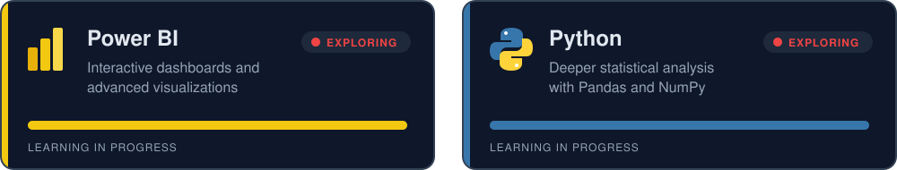

  
  
  
  

## Tarun Sai
**Data Analyst | SQL · Python · Excel · Power BI · Data Cleaning · Exploratory Data Analysis**

I am a Computer Science and Engineering graduate (B.Tech, Data Science specialization) from Mohan Babu University, Tirupati. I focus on cleaning raw datasets, analyzing them with SQL, Python, Excel and Power BI, and presenting the findings clearly.

I am currently seeking full-time Data Analyst roles and internships.

**Location:** Proddatur, Andhra Pradesh, India

### Connect with me

---

### Featured Projects

  
  

---

### Tech Stack

<b>Show all tools</b>

 

**Languages**

**Databases**

**Python Libraries**

**BI and Spreadsheets**

**Tools**

**Concepts:** Data Cleaning · Exploratory Data Analysis · Descriptive Statistics

---

### Currently Exploring

---

### GitHub Stats

---

### Beyond Data

  
  

---

<picture>
  <source media="(prefers-color-scheme: dark)" srcset="https://raw.githubusercontent.com/Tarun-Sai99/Tarun-Sai99/output/f1-contrib-dark.svg" />
  <source media="(prefers-color-scheme: light)" srcset="https://raw.githubusercontent.com/Tarun-Sai99/Tarun-Sai99/output/f1-contrib-light.svg" />
  
</picture>

 COMMIT; Query OK, 1 visit recorded. Thanks for watching. Post-credits scene: next project loading." width="100%" />

  

